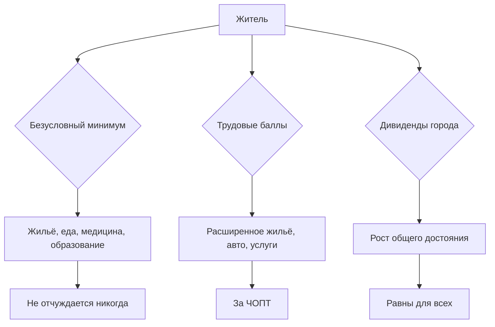
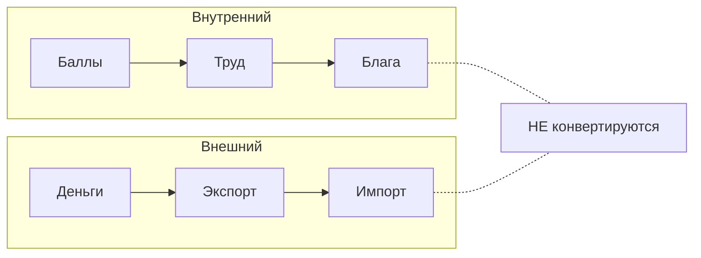
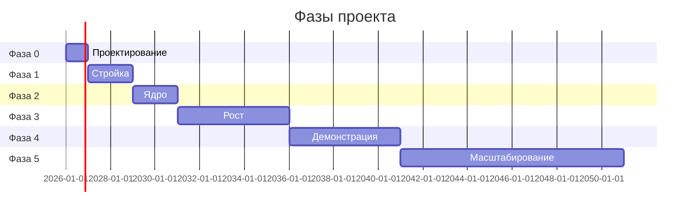
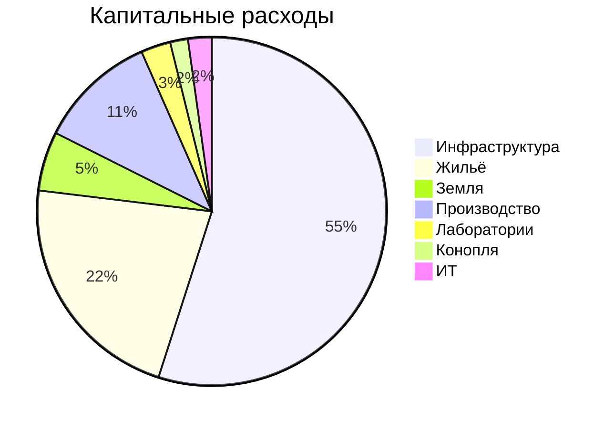
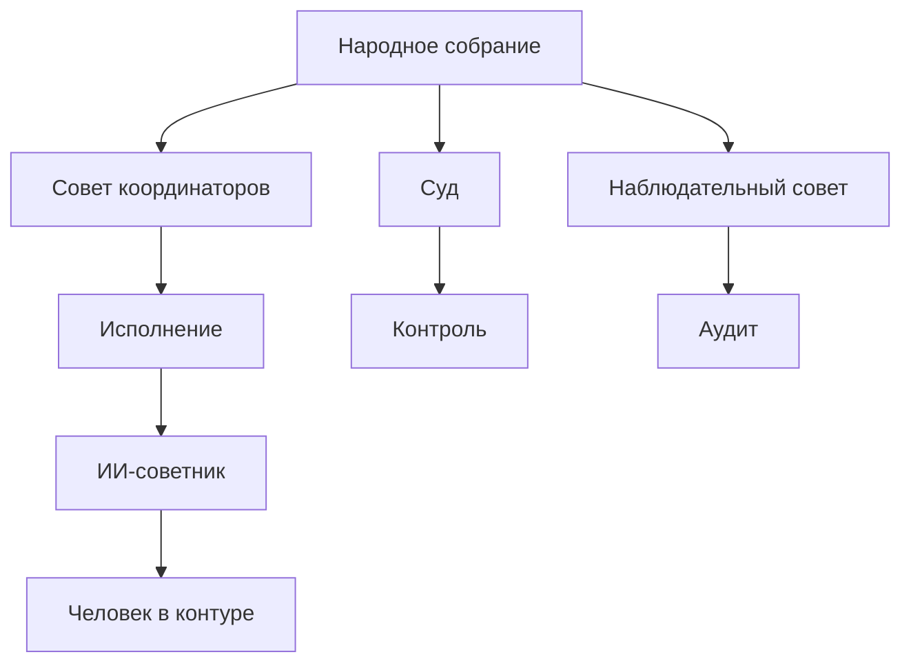
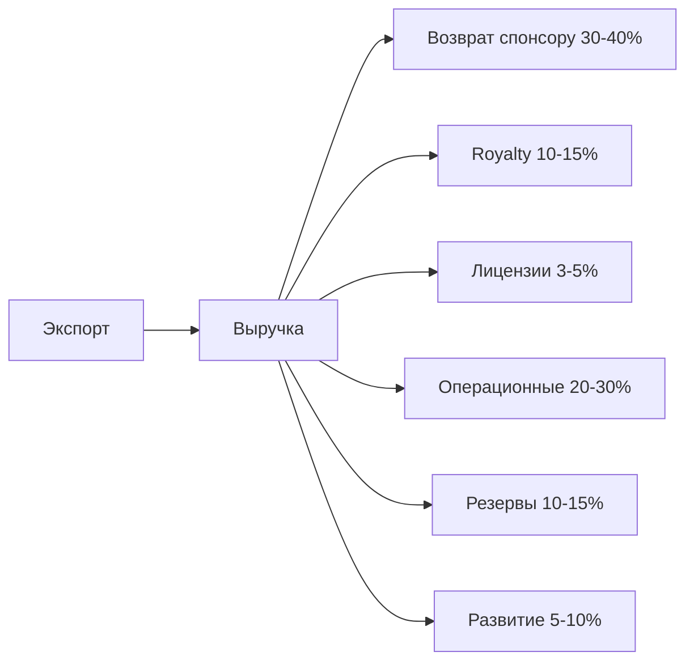
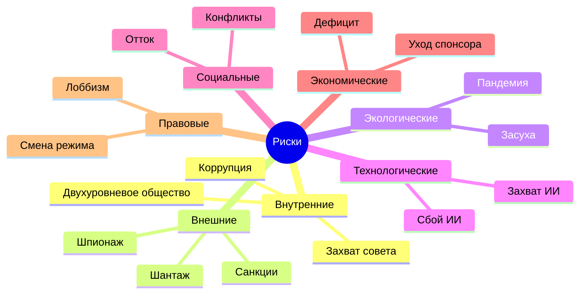

# Визуализации проекта
v3.12 | 2026-10-14

Схемы и диаграммы. Рендерятся на GitHub автоматически.

## 1. Структура репозитория
```
constitution-rbe/
├── README.md
├── VISUAL.md              <- этот файл
├── SKILL.md
├── constitution/          <- 37 модулей
│   ├── Этапы (-1, 00, 01)
│   ├── Устав (02, 02a, 03)
│   ├── Экономика (03a-03e)
│   ├── Договоры (04)
│   ├── Оборот (05, 06)
│   ├── Социальные (09-22)
│   ├── Периферия (23-29)
│   └── Расчёты (30-38)
├── experience/            <- 3 файла
└── reference/             <- 12 справочников
```

## 2. Модель Гибрид F


## 3. Два контура экономики


## 4. Дорожная карта (25 лет)


## 5. Бюджет 25 лет (млн руб.)


## 6. Управление


## 7. Финансовые потоки


## 8. Красная команда (7 категорий)


## 9. Итог

70 файлов, 37 модулей, 12 справочников, 22 урока.
