# Визуализации проекта
v3.24 | 2026-10-14

Схемы и диаграммы. Рендерятся на GitHub автоматически.

## 1. Структура репозитория
```
constitution-rbe/
├── README.md
├── VISUAL.md              <- этот файл
├── SKILL.md
├── constitution/          <- 37 модулей
│   ├── Этапы (-1, 00, 01)
│   ├── Устав (02, 02a, 03)
│   ├── Экономика (03a-03e)
│   ├── Договоры (04)
│   ├── Оборот (05, 06)
│   ├── Социальные (09-22)
│   ├── Периферия (23-29)
│   └── Расчёты (30-38)
├── experience/            <- 3 файла
└── reference/             <- 12 справочников
```

## 2. Модель Гибрид F
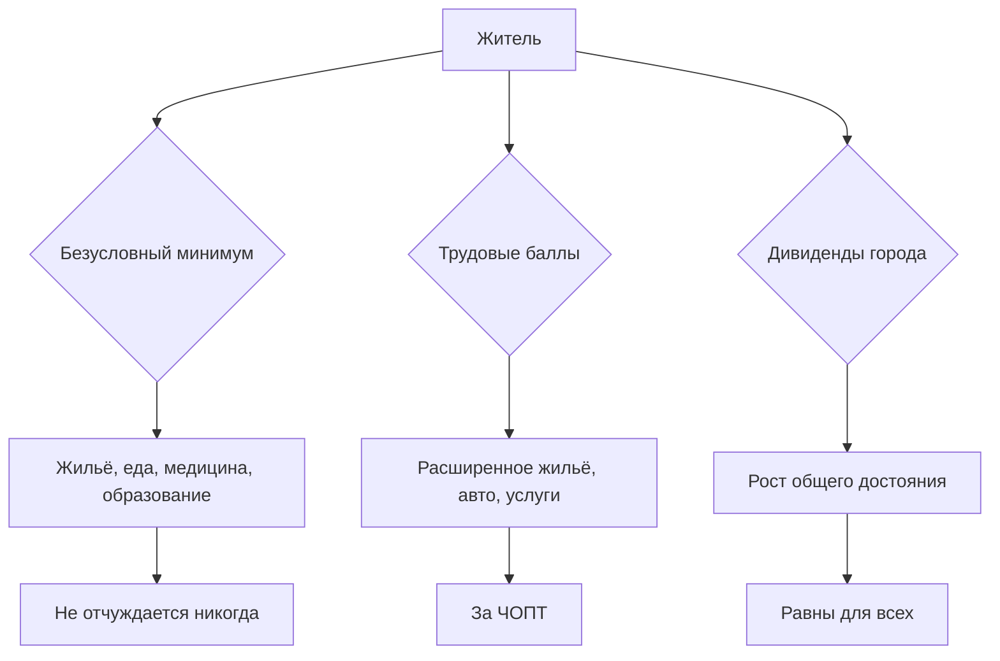

## 3. Два контура экономики
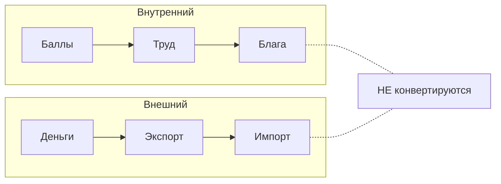

## 4. Дорожная карта (25 лет)
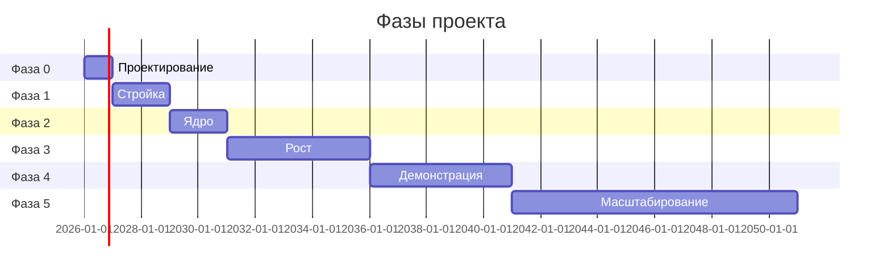

## 5. Бюджет 25 лет (млн руб.)
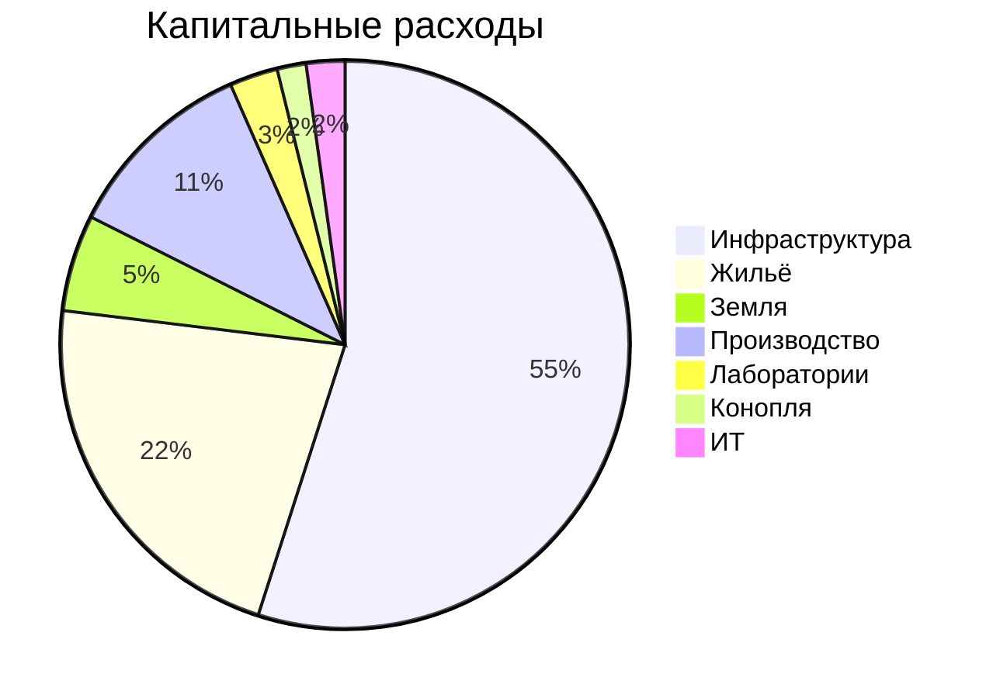

## 6. Управление
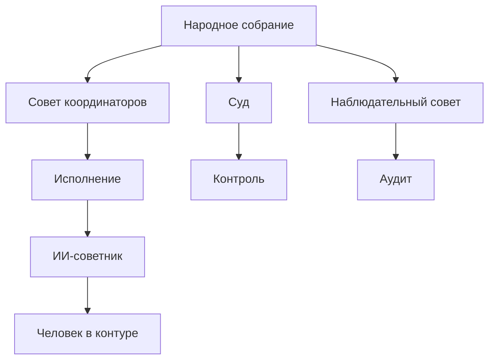

## 7. Финансовые потоки
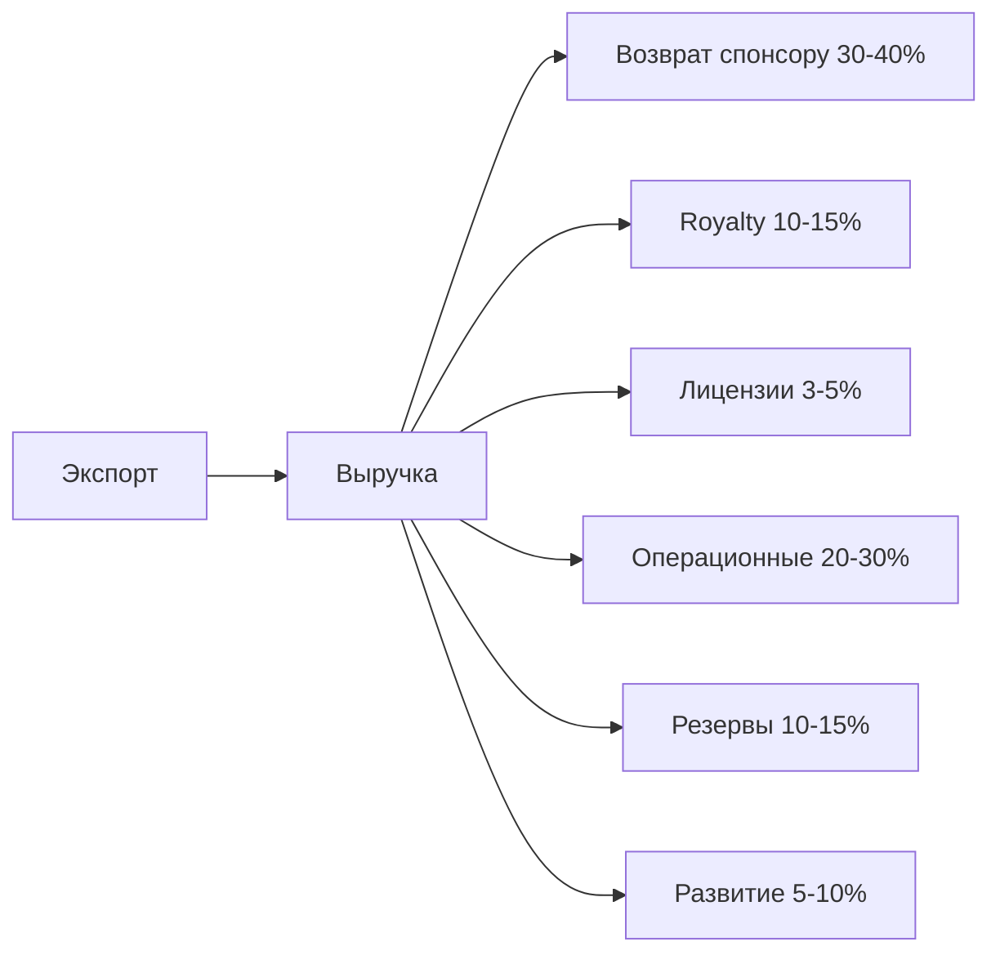

## 8. Красная команда (7 категорий)
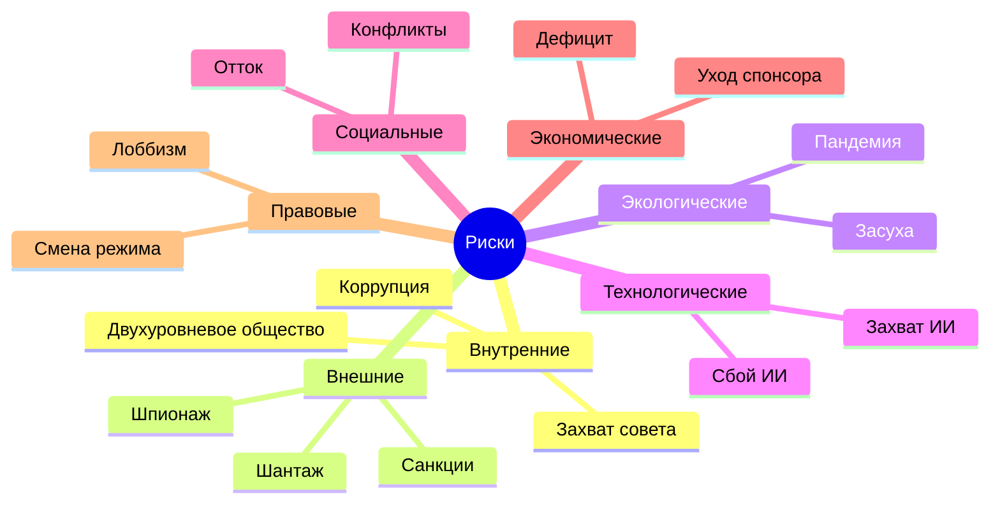

## 9. Итог

76 файлов, 41 модуль, 12 справочников, 22 урока.

## 10. Путь жителя

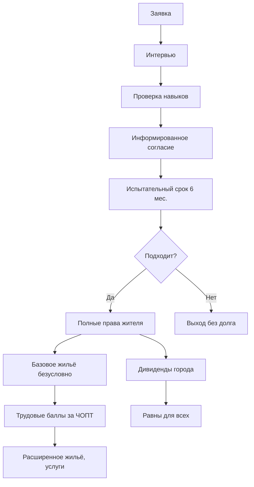

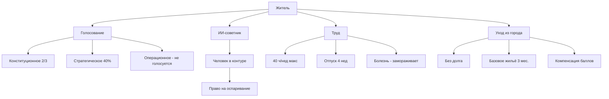

### Пошагово

1. Заявка через портал.
2. Интервью и проверка навыков.
3. Подписание устава и информированное согласие.
4. Испытательный срок 6 месяцев.
5. Полные права, базовое жильё.
6. Труд, баллы, дивиденды.
7. Голосование, ИИ-советник.
8. Уход - в любой момент, без долга.

## 11. Планировка города

### Зонирование (условно, 500-800 га)

```
                    АГРО-ЗОНА
                  (поля, теплицы)
                         |
                         |
  +----------------------+----------------------+
  |                      |                      |
  |   ЖИЛОЙ РАЙОН 1      |   ОБЩЕСТВЕННЫЙ       |   ЖИЛОЙ РАЙОН 2
  |   (малоэтажный)      |   ЦЕНТР               |   (среднеэтажный)
  |                      |   (школы, больницы,  |
  |   парк, детсад       |    культура, админ)  |   парк, спорт
  |                      |                      |
  +----------------------+----------------------+
                         |
                         |
  +----------------------+----------------------+
  |                      |                      |
  |   ЖИЛОЙ РАЙОН 3      |   ПРОИЗВОДСТВЕННАЯ   |   ЛОГИСТИКА
  |   (дома с участками) |   ЗОНА               |   (склады, ж/д)
  |                      |   (заводы, лабы)     |
  |   сады, огороды      |                      |   грузовой терминал
  |                      |                      |
  +----------------------+----------------------+
                         |
                         |
                  РЕКРЕАЦИОННАЯ ЗОНА
                  (парки, водоёмы, лес)
```

### Связи между зонами

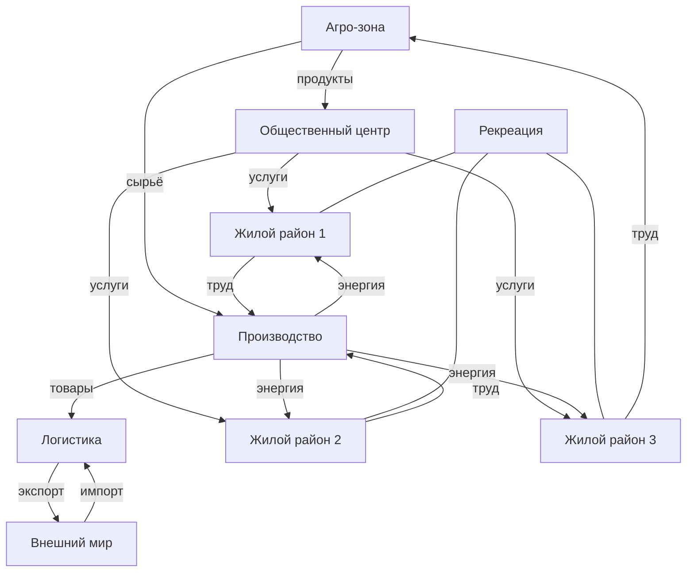

### Принципы планировки

- Шаговая доступность 10-15 мин до всего.
- Пешеход и велосипед в приоритете.
- Личный авто ограничен в центре.
- Промзона отделена зелёной полосой 100-200 м.
- Зелень >50 м2/чел.
- Этажность 3-5 этажей, без небоскрёбов.
- Каждый дом - с подвалом/укрытием.
- Плотность 30-50 чел/га.


## 12. Стратегическая автономия

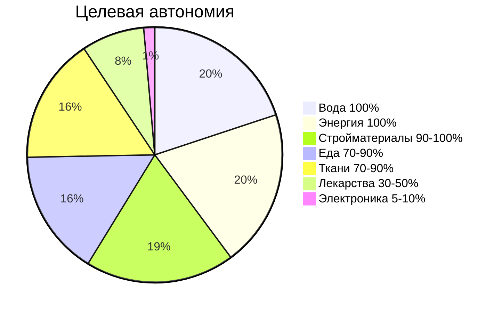

### Что выдерживает город

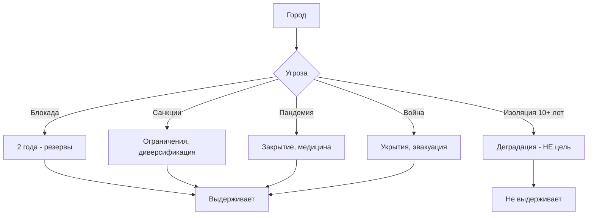

### Ключевые резервы

- Продовольствие: 2 года.
- Вода: 2 года.
- Лекарства: 6-12 месяцев.
- Топливо: 6 месяцев.
- Энергия: 48 часов (накопители).
- Поставщиков на критичный товар: минимум 3.

См. модуль [39-autonomy.md](constitution/39-autonomy.md).

